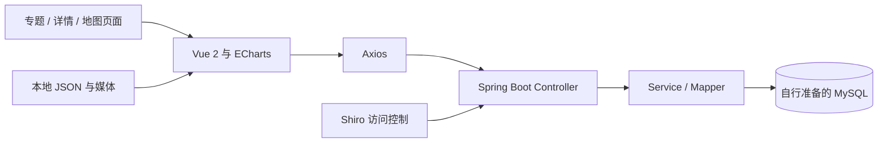

# 乡画 · 非遗与农特产可视化平台

将乡村非遗、农特产内容展示与地图、词云、统计图结合的课程团队作品。项目保留 Vue 2 展示端，以及管理用户、非遗条目、农产品和评论的 Spring Boot 后端，适合了解内容型网站与可视化页面的组织方式。

**课程团队项目 · 项目负责人 / 维护者：迟凡杰。** 页面、业务代码和素材由团队协作完成。

[展示页面](frontend/src/views/front/) · [可视化数据](frontend/src/assets/) · [后端接口](backend/src/main/java/com/example/rrmplatform/controller/) · [前端配置示例](frontend/.env.example) · [后端配置示例](backend/src/main/resources/application.example.yml)

## 功能与代码入口

| 场景 | 实现入口 |
| --- | --- |
| 首页与专题入口 | `frontend/src/views/Prepare.vue`、`views/front/Home.vue` |
| 非遗展示与详情 | `feiyiMain.vue`、`feiyiItem.vue`，结合本地条目数据 |
| 农特产展示与详情 | `nongMain.vue`、`nongItem.vue`，含词云与统计图配置 |
| 地图与区域可视化 | `huapianMain.vue`、`huapianProvince.vue`，使用 ECharts 和本地点位 |
| 内容与评论接口 | `HeritageController`、`GoodController`、`CommentController` |
| 账户与访问控制 | `UserController`、Shiro 配置与 Realm |

前端使用本地 JSON 展示课程示例内容，账户、评论等交互由后端提供；图表数据用于演示，不作实时更新。

## 技术与架构

- 前端：Vue 2、Vue CLI 4、Vue Router、Vuex、Element UI、Axios、ECharts、echarts-wordcloud、Video.js。
- 后端：Java 8、Spring Boot 2.7.5、MyBatis-Plus、MySQL、Apache Shiro。



```text
frontend/src/views/front/  主题展示、地图、详情与图表
frontend/src/assets/       地图、词云、条目和点位数据
frontend/src/utils/request.js  后端请求封装
frontend/.env.example      本机后端地址示例
backend/src/main/java/com/example/rrmplatform/
  controller/、service/    内容接口与业务处理
  mapper/、pojo/          数据访问与实体
  config/                 Shiro 与 MyBatis 配置
backend/src/main/resources/mapper/  SQL 映射
```

## 本地查看与复现准备

本仓库保留前后端源码；复现需补齐数据库结构、初始化数据和部分媒体资源。以下为工程入口和必要条件，完整构建与端到端运行尚待验证。

### 前端入口

在 `frontend/` 中运行：

```sh
npm install
npm run serve
# 构建入口：npm run build
```

项目仍依赖 `node-sass@4.14.1` 与 Vue CLI 4，现代 Node.js 环境可能遇到依赖或本机编译兼容问题。复现时应先准备隔离的历史兼容环境，或另行迁移依赖；本版本没有验证现代环境兼容性。

将 `.env.example` 复制为 `.env.local`，配置 `VUE_APP_API_BASE_URL`。开发服务器为 `127.0.0.1:8081`，可以从 `/prepare` 或 `/front/home` 查看页面。原有 history 路由在静态部署时需要服务器提供回退配置。

### 后端准备

1. 用 Java 8 和 Maven 导入 `backend/pom.xml`。
2. 从 `src/main/resources/application.example.yml` 创建 `application-local.yml`，设置 `SPRING_PROFILES_ACTIVE=local`。
3. 提供 `DB_URL`、`DB_USERNAME`、`DB_PASSWORD`，准备与实体和 Mapper 一致的数据库表及合成演示数据。
4. 条件具备后运行 `com.example.rrmplatform.RrmPlatformApplication`；也可在 `backend/` 执行 `mvn spring-boot:run`。

示例后端端口为 `9090`。仓库未附建表 SQL 和默认账号，需结合实体与 Mapper 初始化本地数据库。

## 数据、素材与当前限制

- `src/assets/` 的非遗、农产品、地图、企业点位与图表数据保留课程演示用途，但缺少完整的采集时间、许可和来源清单。不要将数值当作实时统计、完整名录或商业分析结论。
- 部分页面保留公开网站链接和远程图片，访问时可能向来源网站请求资源；可用性与素材权利由对应来源决定。
- 部分图片和音视频未归档，相关区域可能出现空白或资源缺失；暂无核验过的运行截图和端到端测试结果。
- 后端保留课程阶段的账户和权限实现，尚未进行生产级安全评审。例如管理员注册路由仍存在，不能直接对公网开放服务。

## 团队贡献与来源

项目由课程团队协作完成，成员贡献以实际分工和提交记录为准。第三方署名和原有说明予以保留。

仓库目前没有统一的项目 LICENSE。公开源码不等于对第三方地图、图片、文本及全部团队代码授予再分发许可，复用前应确认对应来源的授权范围。
